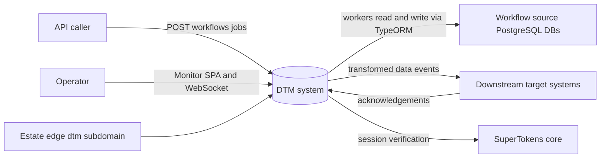
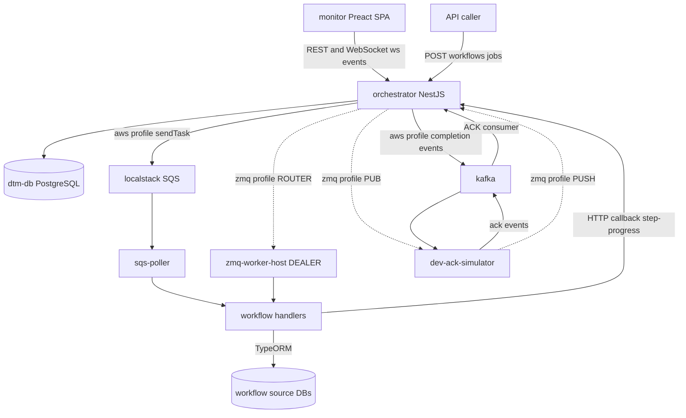
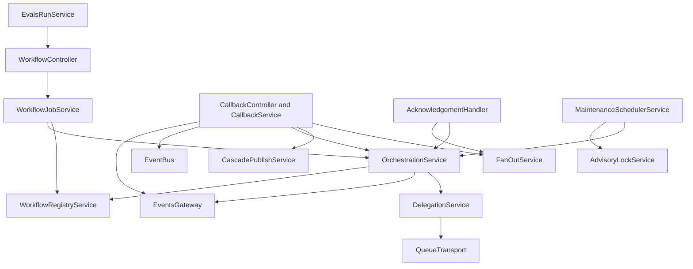
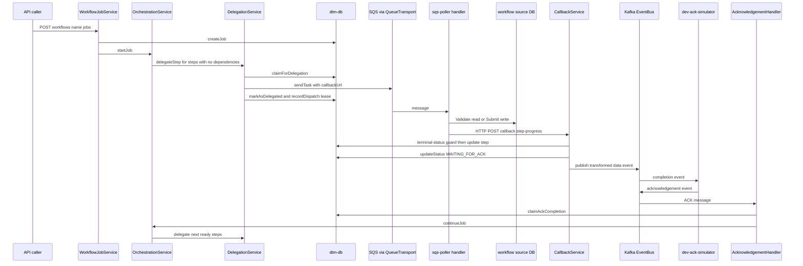
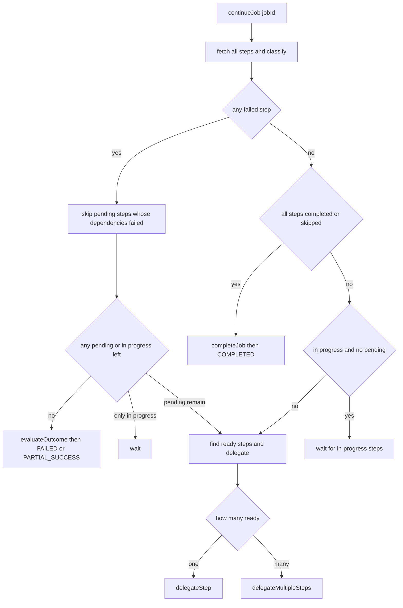

# setpoint-evals-dtm-examples — C4 architecture

> Derived from: CLAUDE.md, pnpm-workspace.yaml, docker-compose.yml, docker-compose.kafka.yml, docker-compose.workers.yml, docker-compose.zmq.yml, services/orchestrator/src/app.module.ts, services/orchestrator/src/main.ts, services/orchestrator/src/transport/transport.module.ts, services/orchestrator/src/event-bus/event-bus.module.ts, services/orchestrator/src/ingestion/workflow-job.service.ts, services/orchestrator/src/delegation/delegation.service.ts, services/orchestrator/src/callback/callback.service.ts, services/orchestrator/src/kafka/handlers/acknowledgement.handler.ts, services/orchestrator/src/orchestration/orchestration.service.ts, tools/sqs-poller/src/poller.ts, tools/zmq-worker-host/src/host.ts, packages/database/src/entities/step.entity.ts, docker-compose.yml ports (verified 2026-10-12)

> A **C4-model** view of setpoint-evals-dtm-examples, the generic DTM (Distributed Task Manager): a pnpm-workspaces monorepo holding a NestJS orchestrator, stateless per-step workers, a Preact monitor and a pluggable set of example workflows, all proven by a corpus of Setpoint Evals (SEs). The estate atlas places the project as one registry row; the existing guide `docs/guides/architecture-c4.md` gives a shallow orientation in C4-PlantUML-style diagrams. This document is the authored counterpart in the estate's template: the containers each pinned to a file, the orchestrator's internal components, the life of one job across them, and the invariants with their choke points.

## Why this is a doc, not derivable

A flat port list (orchestrator, dev-ack-simulator, monitor, five PostgreSQL ports, Kafka, LocalStack, Kafka UI, a debugger port) draws one box with a long list of ports. It cannot show what the source shows. The container set is not fixed: four compose files are layered (`docker-compose.yml`, `docker-compose.kafka.yml`, `docker-compose.workers.yml`, `docker-compose.zmq.yml`), and two environment switches, `QUEUE_TRANSPORT` (`services/orchestrator/src/transport/transport.module.ts::QUEUE_TRANSPORT`) and `EVENT_BUS` (`services/orchestrator/src/event-bus/event-bus.module.ts::EVENT_BUS`), decide at module-load time which transport and which bus the orchestrator instantiates, so the same image runs with SQS plus Kafka or with ZeroMQ only. A port list cannot express the data-access boundary either: workers read and write the workflow source databases, the orchestrator never does, and the only channel back is an HTTP callback. Nor can it show the orchestrator's component graph (a registry of workflows loaded at boot, a delegation service, a callback service, a fan-out service, an ACK handler, a maintenance scheduler), the step lifecycle that crosses four containers, or the posture facts that differ from a port-list reading: the stack is labelled as unauthenticated while the orchestrator registers a global SuperTokens guard with a dev escape hatch. These are internal structure and decisions rather than container rows, so they are authored here once and pinned by the Verified section. Where this document and `CLAUDE.md` or the compose files disagree, the Deployment view says so.

## C4 Level 1 — System context of setpoint-evals-dtm-examples

The people and external systems, each read from a file:

- **API caller**: a person with curl or a script, or an upstream service, submitting a job to the generic workflow endpoint (`services/orchestrator/src/ingestion/workflow.controller.ts`, route `POST /api/v1/workflows/:workflowName/jobs`).
- **Operator**: watches jobs in the Monitor SPA, browses and re-runs SEs (`apps/monitor/src/hooks/use-evals.ts`, `apps/monitor/src/hooks/use-websocket.ts`). Login goes through SuperTokens (`services/orchestrator/src/auth/supertokens.config.ts`, `apps/monitor/src/auth`).
- **Workflow source databases**: one PostgreSQL per example workflow holding the domain entities the Validate and Submit steps touch (`workflows/order-processing/source-db`, `CLAUDE.md` section "Workflow Source DBs").
- **Downstream target systems**: the systems that receive the transformed data and send an acknowledgement back. In development the dev-ack-simulator plays them (`tools/dev-ack-simulator/src/main.ts`).
- **SuperTokens core**: the shared identity service the orchestrator's auth module initialises against (`services/orchestrator/src/auth/supertokens.config.ts`).
- **Local edge**: the monitor is served by the Vite dev server (`apps/monitor/vite-dev.config.ts`); no hosted edge is described by any file in this repository.



## C4 Level 2 — Containers of setpoint-evals-dtm-examples

The container set depends on the bus profile. Rows marked aws exist under the default SQS plus Kafka profile; rows marked zmq exist under `BUS_PROFILE=zmq`. Ports and subdomains are not copied; they live in `registry/services.yaml -> setpoint-evals-dtm-examples`.

| Container | Runtime | Responsibility | Source of truth |
|---|---|---|---|
| orchestrator | NestJS app, global prefix `api/v1`, WebSocket adapter on `/ws/events` | Job and step state machine, delegation, callback and ACK reconciliation, maintenance tasks, evals API | `services/orchestrator/src/main.ts`, `docker-compose.yml` (service `orchestrator`) |
| dtm-db | PostgreSQL 17 | The engine's own state: `dtm_jobs`, `dtm_steps`, `dtm_dead_letters`; it also hosts the copies of the workflow source databases the workers actually read | `docker-compose.yml` (service `db`), `packages/database/src/entities/step.entity.ts` |
| dev-ack-simulator | NestJS app | Plays the downstream system: consumes completion events, publishes acknowledgements (Kafka, or ZeroMQ SUB and PUSH) | `tools/dev-ack-simulator/src/main.ts`, `docker-compose.yml` (service `dev-ack-simulator`) |
| kafka and zookeeper (aws) | Kafka broker with Zookeeper | Completion and ACK topics | `docker-compose.kafka.yml` (services `kafka`, `zookeeper`) |
| localstack (aws) | LocalStack | SQS queues, one per step type | `docker-compose.workers.yml` (service `localstack`) |
| sqs-poller (aws) | Node process, scalable replicas | Polls SQS and runs the workflow handlers (in-process in debug mode, or invokes Lambda through LocalStack) | `tools/sqs-poller/src/poller.ts`, `docker-compose.workers.yml` (service `sqs-poller`) |
| zmq-worker-host (zmq) | Node DEALER process, one workflow per host, scalable | Connects to the orchestrator ROUTER, registers its queues, heartbeats, runs the same handlers in-process | `tools/zmq-worker-host/src/host.ts`, `docker-compose.zmq.yml` (service `zmq-worker-host-order-processing` and two siblings) |
| workflow workers | Handler modules per workflow (Lambda handlers) | Validate, Submit, Discover, Plan, Apply handlers that touch the source DB and call back over HTTP | `workflows/order-processing/workers/src/handlers`, `packages/worker-sdk/src/callbacks.ts` |
| workflow source DBs | PostgreSQL, one per workflow | Domain data for each example workflow | `workflows/order-processing/source-db`, `workflows/order-processing/docker-compose.order-processing.yml` |
| monitor | Preact + Vite SPA (zustand state) | Live job table, step DAG (mermaid), Scenarios tab that lists and runs SEs, WebSocket plus REST polling | `apps/monitor/package.json`, `apps/monitor/src/app.tsx` |
| kafka-ui and kafka-init (aws) | Kafka UI and a topic bootstrap job | Operator view of topics, topic creation | `docker-compose.kafka.yml` (services `kafka-ui`, `kafka-init`) |



## C4 Level 3 — Components of the orchestrator

`AppModule` (`services/orchestrator/src/app.module.ts`) wires TypeORM with `synchronize: false` (schema comes from migrations), the workflow loader, and the modules below. Every path is repo-relative.

- **WorkflowLoaderModule and WorkflowRegistryService** (`services/orchestrator/src/workflow-loader/workflow-registry.service.ts`): holds the registered workflows (`order-processing`, `iot-sensor-pipeline`, `infra-provisioning`, `plan-execution`, imported in `app.module.ts`), resolves defaults, enable and disable state, queue names and ACK topics; `WorkflowConfigService` (`services/orchestrator/src/workflow-loader/workflow-config.service.ts`) evaluates one workflow's definition, and `FeatureFlagService` (`services/orchestrator/src/workflow-loader/feature-flag.service.ts`) layers flags.
- **IngestionModule** (`services/orchestrator/src/ingestion/workflow.controller.ts`, `services/orchestrator/src/ingestion/workflow-job.service.ts`): the generic job entry point; `initiateWorkflowJob` validates the workflow and variant, deduplicates, creates the job and calls `OrchestrationService.startJob`.
- **OrchestrationModule** (`services/orchestrator/src/orchestration/orchestration.service.ts`): `startJob` creates the upfront steps and delegates every step with no dependencies; `continueJob` is the decision brain after each completion or failure; `completeJob`, `failJob` and `partialSuccessJob` finish a job. `FanOutService` (`services/orchestrator/src/orchestration/fan-out.service.ts`) creates and tracks child steps after a discovery step; `CascadePublishService` (`services/orchestrator/src/orchestration/cascade-publish.service.ts`) checks cascade dependencies and injects foreign-key values before publishing.
- **DelegationModule** (`services/orchestrator/src/delegation/delegation.service.ts`): `delegateStep` claims a pending step atomically, builds the payload with the callback URL, sends it through `QueueTransport` and stamps the redelivery lease.
- **TransportModule** (`services/orchestrator/src/transport/transport.module.ts`): provides `QueueTransport` as `SqsTransport`, `CloudTasksTransport` or `ZmqTransport`; each declares honest `capabilities` (`services/orchestrator/src/transport/queue-transport.interface.ts`) and the zmq variant adds `ZmqWorkerRegistryService` and a workers controller.
- **EventBusModule** (`services/orchestrator/src/event-bus/event-bus.module.ts`): provides `EventBus` as `KafkaEventBus` or `ZmqEventBus` (PUB for events out, PULL for acks in); disjoint from the task transport.
- **CallbackModule** (`services/orchestrator/src/callback/callback.controller.ts`, `services/orchestrator/src/callback/callback.service.ts`): receives worker progress on the `callback` controller, ignores duplicates for steps already in a terminal-like status, triggers fan-out, FK injection, the event publish and `continueJob`.
- **KafkaHandlersModule and AcknowledgementHandler** (`services/orchestrator/src/kafka/handlers/acknowledgement.handler.ts`): consumes cascade ACK topics resolved from the registry, claims the WAITING_FOR_ACK to COMPLETED transition atomically, then continues the job.
- **MaintenanceModule** (`services/orchestrator/src/maintenance/maintenance.module.ts`): `MaintenanceSchedulerService` runs the tasks in `services/orchestrator/src/maintenance/tasks/` (stuck-in-progress, stuck-pending, stuck-delegated, stuck-acknowledgement, stuck-waiting-for-children, orphaned-job-recovery, old-job-cleanup, health-metrics, redelivery-engine, event-republish-scan) guarded by `AdvisoryLockService` (`services/orchestrator/src/maintenance/advisory-lock.service.ts`).
- **EvalsModule** (`services/orchestrator/src/evals/evals.controller.ts`, `services/orchestrator/src/evals/evals-discovery.service.ts`, `services/orchestrator/src/evals/evals-run.service.ts`): lists SE READMEs from disk and runs one by re-POSTing the README's own payload through the generic job API.
- **WebSocketModule** (`services/orchestrator/src/websocket/events.gateway.ts`): `EventsGateway` serves `/ws/events` and `broadcast`s step and job events to the monitor.
- **AgentEventsModule** (`services/orchestrator/src/agent-events/agent-events.controller.ts`, `services/orchestrator/src/agent-events/agent-forest.service.ts`): ingest of agent-event messages and relay over the WebSocket.
- **AuthModule** (`services/orchestrator/src/auth/auth.module.ts`, `services/orchestrator/src/auth/auth.guard.ts`): initialises SuperTokens, registers a global `AuthGuard` and the SuperTokens middleware.
- **JobsModule, MetricsModule and HealthModule** (`services/orchestrator/src/jobs/jobs.controller.ts`, `services/orchestrator/src/metrics/metrics.controller.ts`, `services/orchestrator/src/health/`): read APIs for job and step detail, throughput buckets and health.



## C4 Level 3 — Components of the worker side

- **sqs-poller** (`tools/sqs-poller/src/poller.ts`): discovers queues (`tools/sqs-poller/src/queue-discovery.ts`), receives messages, and either runs the handler in-process when `DEBUG_SERVER_MODE` is true or invokes the Lambda through LocalStack; the handler map is `tools/sqs-poller/src/handler-registry.ts`.
- **zmq-worker-host** (`tools/zmq-worker-host/src/host.ts`): one workflow per host; HELLO, heartbeat, receipt-ack and in-process dispatch (`tools/zmq-worker-host/src/dispatch.ts`, `tools/zmq-worker-host/src/handler-registry.ts`).
- **worker-sdk** (`packages/worker-sdk/src/callbacks.ts`): `sendInProgressCallback`, `sendSuccessCallback` and `sendFailureCallback` post to the callback URL carried in the task payload; handler code is identical under both profiles.
- **Workflow handlers** (`workflows/order-processing/workers/src/handlers`): per-step modules such as `validate-customer.ts` and `submit-order.ts`; each workflow's DAG is declared in its `workflow.config.ts` (for example `workflows/order-processing/workflow.config.ts`), typed by `packages/core/src/interfaces/workflow-definition.interface.ts`.
- **Shared packages**: `packages/database` (entities `job.entity.ts`, `step.entity.ts`, `dead-letter.entity.ts`, repositories, migrations), `packages/kafka-consumer`, `packages/kafka-producer`, `packages/errors`, `packages/core`.

## Dynamic view — one job from API call to completion (aws profile)

The path below is read from the code: ingestion creates and starts the job (`services/orchestrator/src/ingestion/workflow-job.service.ts`), delegation claims and sends (`services/orchestrator/src/delegation/delegation.service.ts`), the worker posts back (`packages/worker-sdk/src/callbacks.ts`), the callback service sets WAITING_FOR_ACK before publishing and the ACK handler claims the completion (`services/orchestrator/src/callback/callback.service.ts`, `services/orchestrator/src/kafka/handlers/acknowledgement.handler.ts`).



## Dynamic view — the continueJob decision

`continueJob` runs after every step completion or failure (`services/orchestrator/src/orchestration/orchestration.service.ts::continueJob`). The branches below follow the numbered cases in its body; the full tree and its race notes live in `docs/guides/orchestration-decision-logic.md`.



## Deployment view

Placement is proven by the layered compose files: `docker-compose.yml` (orchestrator, db, dev-ack-simulator, an init-typeorm migration job), `docker-compose.kafka.yml` (zookeeper, kafka, kafka-ui, kafka-init), `docker-compose.workers.yml` (sqs-poller, init-sqs-queues, localstack) and `docker-compose.zmq.yml` (overrides for the orchestrator and simulator plus three `zmq-worker-host-*` services under the `zmq-tasks` profile). The deployment method is docker-compose; the published ports are read from the compose files and not copied here.

| Item | Port-list reading | Source says | Verdict |
|---|---|---|---|
| auth | labelled unauthenticated | `AuthModule.forRoot()` registers a global `AuthGuard` (`services/orchestrator/src/auth/auth.module.ts`), which waves requests through only when `DISABLE_AUTH` is `true` (`services/orchestrator/src/auth/auth.guard.ts`) | that label describes the dev default, not the code path |
| source DBs | `docker-compose.yml` publishes five PostgreSQL ports, three of them source DBs | `CLAUDE.md` states the workers read the copies hosted in `dtm-db`, not the dedicated source containers | the dedicated containers are not what the deployed workers read |
| workflows | not listed | four workflows are registered in `services/orchestrator/src/app.module.ts` (`plan-execution` in addition to the three listed in `CLAUDE.md`) | `CLAUDE.md` table is behind the code |
| ZeroMQ ports | not listed | ROUTER, PUB and PULL bind in the orchestrator (`services/orchestrator/src/transport/zmq-transport.service.ts`, `services/orchestrator/src/event-bus/zmq-event-bus.service.ts`) | a port-list reading for the default profile omits the zmq profile |

The monitor is a Vite app (`apps/monitor/vite.config.ts`, `apps/monitor/vite-dev.config.ts`). Remote, hosted deployment of the monitor and the orchestrator is not described by any file read for this document: absent.

## Invariants this architecture must preserve

1. **The orchestrator never reads a workflow source database; workers do, and report back by HTTP callback.** Choke point: `packages/worker-sdk/src/callbacks.ts::sendSuccessCallback`. Reds if neutered: no SE targets the boundary directly, so it is unverified (the orchestrator's source tree has no import of any `source-db` package, which the Verified section re-derives).
2. **A pending step is delegated at most once under concurrent `continueJob` calls.** Choke point: `packages/database/src/repositories/step.repository.ts::claimForDelegation`. Reds if neutered: `setpoint-evals/SE-05-concurrent-jobs`.
3. **A duplicate worker callback for a step already past its working state is ignored, so a redelivered discovery message cannot create a second batch of children.** Choke point: `services/orchestrator/src/callback/callback.service.ts::TERMINAL_STATUSES`. Reds if neutered: `workflows/iot-sensor-pipeline/setpoint-evals/SE-03-double-fan-out`.
4. **An acknowledgement completes a step exactly once.** Choke point: `packages/database/src/repositories/step.repository.ts::claimAckCompletion`, used in `services/orchestrator/src/kafka/handlers/acknowledgement.handler.ts::claimAckCompletion`. Reds if neutered: `setpoint-evals/SE-07-stuck-ack-recovery` covers the stuck-ACK path; the double-delivery race itself is covered by the iot double-fan-out SE named above.
5. **A step is marked WAITING_FOR_ACK before its event is published**, so a fast ACK is never ignored. Choke point: `services/orchestrator/src/callback/callback.service.ts::WAITING_FOR_ACK`. No SE isolates the ordering: unverified.
6. **Exactly one transport instance binds the ZeroMQ sockets.** Choke point: `services/orchestrator/src/transport/transport.module.ts::useExisting`. Reds if neutered: `setpoint-evals/SE-36-full-zmq-bus-profile` (a duplicate instance dies on EADDRINUSE at boot).
7. **When the active transport does not redeliver, the orchestrator-driven redelivery engine takes over from delegation leases and writes dead letters.** Choke point: `services/orchestrator/src/transport/queue-transport.interface.ts::isRedeliveryEngineActive`. Reds if neutered: `setpoint-evals/SE-29-redelivery-lease-expiry`.
8. **Maintenance tasks run on one orchestrator replica at a time.** Choke point: `services/orchestrator/src/maintenance/advisory-lock.service.ts::pg_try_advisory_lock`. Reds if neutered: `setpoint-evals/SE-15-leader-election-concurrency`.
9. **The eval run endpoint is dev-only and can be switched off.** Choke point: `services/orchestrator/src/evals/evals-run.service.ts::ENABLE_EVAL_RUN_API`. Reds if neutered: `setpoint-evals/SE-19-evals-run-api-disabled-403`.
10. **The schema comes from migrations only (`synchronize: false`).** Choke point: `services/orchestrator/src/app.module.ts::synchronize: false`. Reds if neutered: `setpoint-evals/SE-14-schema-single-source` compares a bootstrapped database to a bare migration run.

## Verified (2026-10-12)

<!-- VERIFICATION-SUMMARY -->
Read-only commands that re-derive the claims above. Not executed: any container start, the SE corpus, a job submission, a deploy; no live service was touched.

```bash
# the four registered workflows
grep -n "Workflow } from '@dtm-workflows" services/orchestrator/src/app.module.ts
# observed: orderProcessingWorkflow, iotSensorPipelineWorkflow, infraProvisioningWorkflow, planExecutionWorkflow

# the transport and event bus are selected from env at module load
grep -n "process.env.QUEUE_TRANSPORT\|process.env.EVENT_BUS" services/orchestrator/src/transport/transport.module.ts services/orchestrator/src/event-bus/event-bus.module.ts
# observed: one match in each file, defaults sqs and kafka

# the orchestrator tree does not import any workflow source-db package
grep -rln "source-db" services/orchestrator/src --include=*.ts | grep -v spec
# observed: no match

# the compose services per layer
grep -n "^  [a-z0-9-]*:$" docker-compose.yml docker-compose.kafka.yml docker-compose.workers.yml docker-compose.zmq.yml
# observed: orchestrator, db, dev-ack-simulator, init-typeorm; zookeeper, kafka, kafka-ui, kafka-init; sqs-poller, init-sqs-queues, localstack; three zmq-worker-host services

# the atomic claims that carry invariants 2 and 4
grep -n "async claimForDelegation\|async claimAckCompletion" packages/database/src/repositories/step.repository.ts
# observed: both methods present

# the published ports this document is compared with
grep -n "^ *- \"[0-9]*:" docker-compose.yml docker-compose.kafka.yml docker-compose.workers.yml
# observed: host:container port mappings where published, including the orchestrator 3002 and the debugger port
```
<!-- /VERIFICATION-SUMMARY -->

## References (don't duplicate)

- **Up — initiative:** — none (no estate-atlas initiative directory names this project in the files read)
- **Up — project index:** [`../README.md`](../README.md)
- **Down — runbooks:** `docs/guides/bus-profiles.md` · **Down — guides:** `docs/guides/architecture-c4.md`, `docs/guides/system-architecture.md`, `docs/guides/orchestration-decision-logic.md` · **Down — features:** `docs/guides/FEATURES.md` · **Down — videos:** `docs/guides/DEMO-VIDEOS.md`
- **Where the proofs live:** `setpoint-evals/SE-05-concurrent-jobs/README.md`, `setpoint-evals/SE-15-leader-election-concurrency/README.md`, `setpoint-evals/SE-19-evals-run-api-disabled-403/README.md`, `setpoint-evals/SE-29-redelivery-lease-expiry/README.md`, `setpoint-evals/SE-36-full-zmq-bus-profile/README.md`, `setpoint-evals/SE-14-schema-single-source/README.md`
- **Design history:** — none
