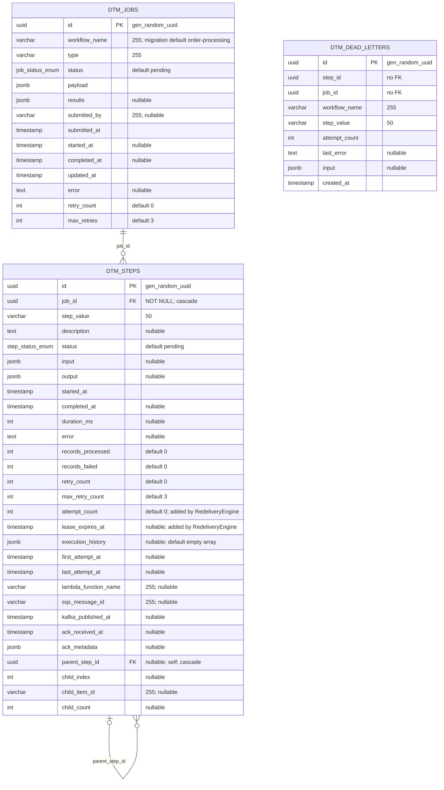
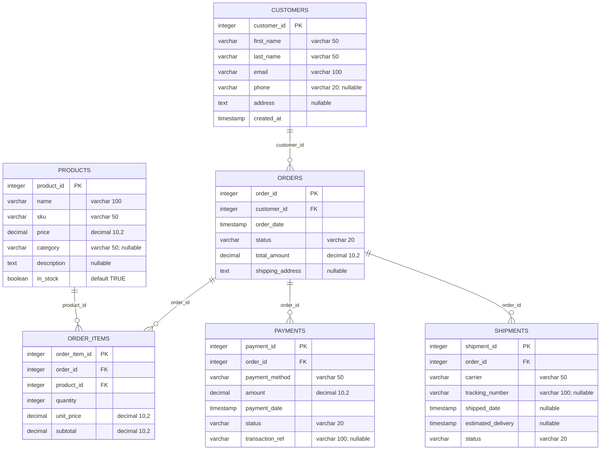
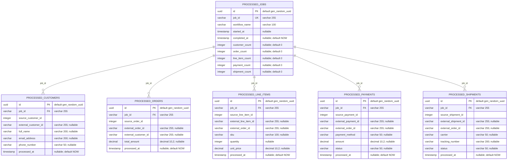
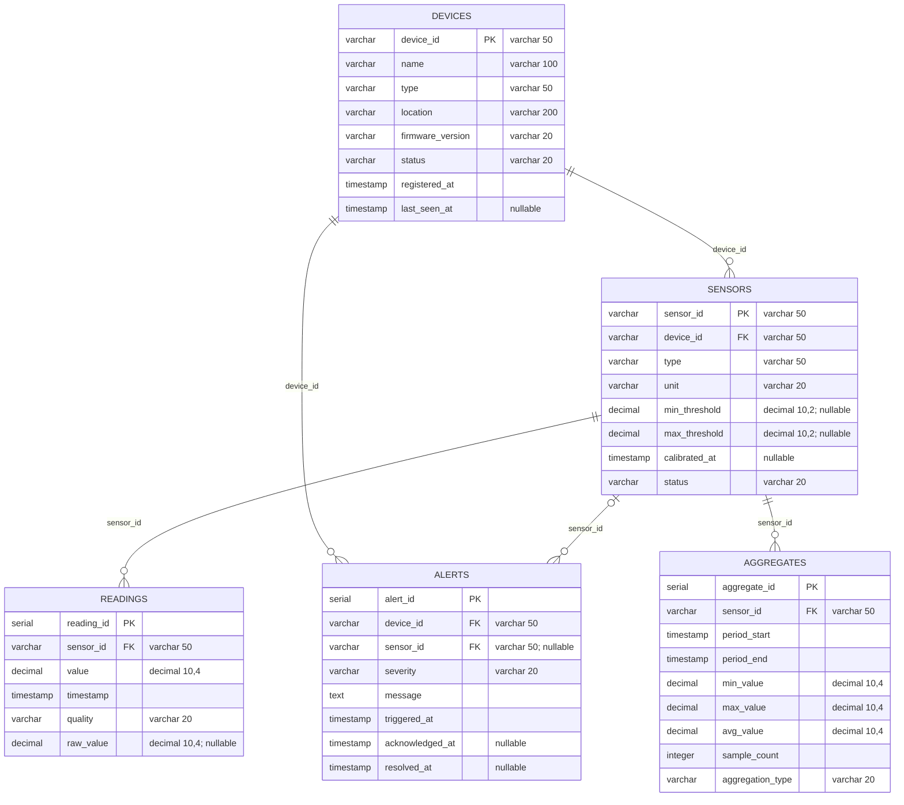
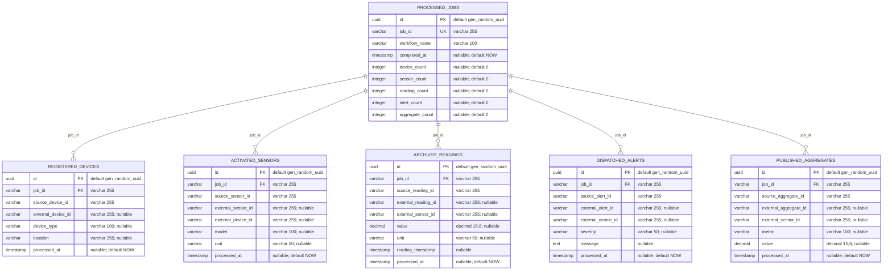
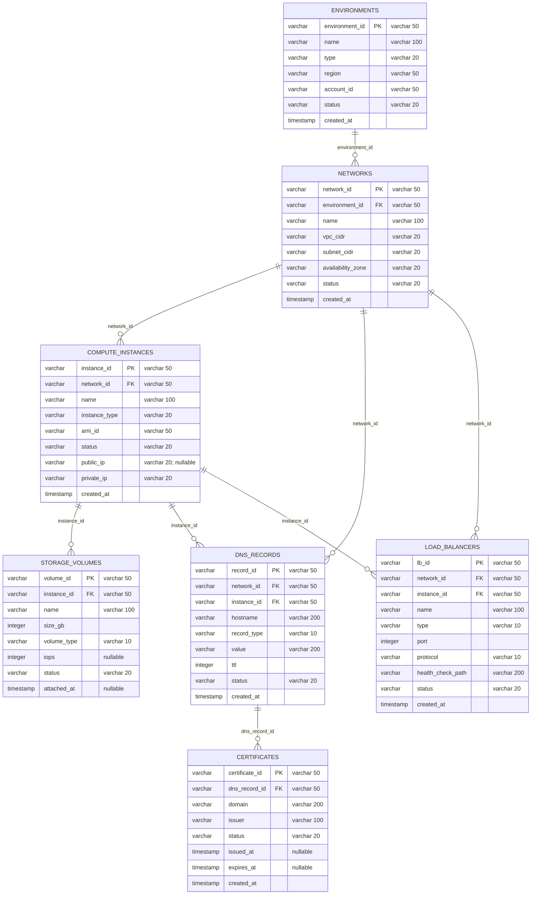

# setpoint-evals-dtm-examples — ERD (the PostgreSQL data model)

> Derived from: packages/database/src/entities/{job,step,dead-letter}.entity.ts, packages/database/src/migrations/1784147958000-InitialSchema.ts, packages/database/src/migrations/1785307727576-RedeliveryEngine.ts, packages/database/src/config/typeorm.config.ts, workflows/*/source-db/init-scripts/01-schema-and-seed.sql, scripts/docker/init-all-databases.sh (verified 2026-10-12)

> An **entity-relationship** view of the one PostgreSQL server this repo runs (the `dtm-db`
> container): which tables, keys and relations exist, and exactly what shape each carries. The
> answer in one line: **one core database (`dtm`) with 3 tables that drive orchestration, plus
> 6 example databases (a source and a product database for each of 3 sample workflows) holding
> 38 tables between them.** Every table, column, type and key below is read from the entity,
> migration or SQL file named beside it. The component and runtime views live in the
> architecture document `setpoint-evals-dtm-examples-c4-architecture.md`, which this page does
> not repeat.

## Which file is the truth (read this first)

| Database | Created by | Entities present | `synchronize` | Truth |
|---|---|---|---|---|
| `dtm` (core, 3 tables) | the 2 TypeORM migrations in `packages/database/src/migrations/` | `Job`, `Step`, `DeadLetter` | `false` at `packages/database/src/config/typeorm.config.ts:38`, `services/orchestrator/src/config/database.config.ts:38` and `services/orchestrator/src/app.module.ts:73` | **the migrations**, as in any estate service that runs `synchronize: false` |
| `<workflow>_db` (3 source databases, 18 tables) | the seed file `workflows/<wf>/source-db/init-scripts/01-schema-and-seed.sql`, loaded by `scripts/docker/init-all-databases.sh` | one `*.entity.ts` per table under `workflows/<wf>/source-db/src/entities/` | `false` in each `workflows/<wf>/source-db/src/config/datasource.ts` | **the SQL seed file** |
| `<workflow>_product_db` (3 product databases, 20 tables) | inline `CREATE TABLE IF NOT EXISTS` in `scripts/docker/init-all-databases.sh` (lines 59-129, 132-199, 202-292) | one `*.entity.ts` per table under `workflows/<wf>/product-db/src/entities/` | `false` in each `workflows/<wf>/product-db/src/config/datasource.ts` | **the shell script's SQL** |

With `synchronize: false` everywhere, an entity edit creates no column anywhere: the migration
(core) or the SQL file (examples) has to change in the same commit. The core schema has one source: `packages/database/src/migrations/1784147958000-InitialSchema.ts:3-31`
records that the former 11-migration chain was squashed into `InitialSchema` and that the squash
was diffed against the old chain, and the SE `setpoint-evals/SE-14-schema-single-source/README.md`
asserts that the bootstrap script and a bare `migration:run` build identical schemas.

## 1. The core database `dtm` (PostgreSQL, TypeORM)

Three tables, one declared relation chain. `dtm_steps.job_id` references `dtm_jobs.id` and
`dtm_steps.parent_step_id` references `dtm_steps.id` (fan-out parent to child), both
`ON DELETE CASCADE` (`1784147958000-InitialSchema.ts:135-138`; entity side
`step.entity.ts:66-70` and `:233-238`). `dtm_dead_letters` is deliberately **not** related to
either table: `dead-letter.entity.ts:18-21` and `1785307727576-RedeliveryEngine.ts:17-20`
explain that a dead letter is an audit record that must outlive the job cleanup that cascades
through steps, so `step_id` and `job_id` are plain `uuid` columns that hold ids by convention.



Enum types, identical in entity and migration (`1784147958000-InitialSchema.ts:57-62`):

- `job_status_enum`: pending, processing, completed, failed, cancelled, partial_success
  (`job.entity.ts:12-19`).
- `step_status_enum`: pending, delegated, in_progress, in_progress_retrying, completed,
  waiting_for_ack, failed, skipped, partial_success, waiting_for_children. The entity re-exports
  `StepStatus` from `@dtm/core` (`step.entity.ts:12,26`); its values are declared in
  `packages/core/src/interfaces/step-status.enum.ts:22-52` and match the migration's list.

### Columns, with the entity line and the migration line

`dtm_steps.attempt_count` and `lease_expires_at` and the whole of `dtm_dead_letters` arrive in the
second migration (`1785307727576-RedeliveryEngine.ts:26-52`); everything else in the first.

| Table | Column | Type | Null | Default | Entity (path:line) | Migration (path:line) |
|---|---|---|---|---|---|---|
| `dtm_jobs` | `id` | uuid | no | gen_random_uuid() | `packages/database/src/entities/job.entity.ts:97-98` | `packages/database/src/migrations/1784147958000-InitialSchema.ts:67` |
| `dtm_jobs` | `workflow_name` | varchar(255) | no | entity none; migration `'order-processing'` | `packages/database/src/entities/job.entity.ts:100-106` | `packages/database/src/migrations/1784147958000-InitialSchema.ts:68` |
| `dtm_jobs` | `type` | varchar(255) | no | none | `packages/database/src/entities/job.entity.ts:108-112` | `packages/database/src/migrations/1784147958000-InitialSchema.ts:69` |
| `dtm_jobs` | `status` | job_status_enum | no | `pending` | `packages/database/src/entities/job.entity.ts:114-119` | `packages/database/src/migrations/1784147958000-InitialSchema.ts:70` |
| `dtm_jobs` | `payload` | jsonb | no | none | `packages/database/src/entities/job.entity.ts:121-122` | `packages/database/src/migrations/1784147958000-InitialSchema.ts:71` |
| `dtm_jobs` | `results` | jsonb | yes | none | `packages/database/src/entities/job.entity.ts:157-158` | `packages/database/src/migrations/1784147958000-InitialSchema.ts:72` |
| `dtm_jobs` | `submitted_by` | varchar(255) | yes | none | `packages/database/src/entities/job.entity.ts:124-130` | `packages/database/src/migrations/1784147958000-InitialSchema.ts:73` |
| `dtm_jobs` | `submitted_at` | timestamp | no | `CURRENT_TIMESTAMP` | `packages/database/src/entities/job.entity.ts:132-133` | `packages/database/src/migrations/1784147958000-InitialSchema.ts:74` |
| `dtm_jobs` | `started_at` | timestamp | yes | none | `packages/database/src/entities/job.entity.ts:135-136` | `packages/database/src/migrations/1784147958000-InitialSchema.ts:75` |
| `dtm_jobs` | `completed_at` | timestamp | yes | none | `packages/database/src/entities/job.entity.ts:138-139` | `packages/database/src/migrations/1784147958000-InitialSchema.ts:76` |
| `dtm_jobs` | `updated_at` | timestamp | no | `CURRENT_TIMESTAMP` | `packages/database/src/entities/job.entity.ts:141-146` | `packages/database/src/migrations/1784147958000-InitialSchema.ts:77` |
| `dtm_jobs` | `error` | text | yes | none | `packages/database/src/entities/job.entity.ts:148-149` | `packages/database/src/migrations/1784147958000-InitialSchema.ts:78` |
| `dtm_jobs` | `retry_count` | integer | no | 0 | `packages/database/src/entities/job.entity.ts:151-152` | `packages/database/src/migrations/1784147958000-InitialSchema.ts:79` |
| `dtm_jobs` | `max_retries` | integer | no | 3 | `packages/database/src/entities/job.entity.ts:154-155` | `packages/database/src/migrations/1784147958000-InitialSchema.ts:80` |
| `dtm_steps` | `id` | uuid | no | gen_random_uuid() | `packages/database/src/entities/step.entity.ts:63-64` | `packages/database/src/migrations/1784147958000-InitialSchema.ts:107` |
| `dtm_steps` | `job_id` | uuid (FK dtm_jobs.id, ON DELETE CASCADE) | no | none | `packages/database/src/entities/step.entity.ts:66-70` | `packages/database/src/migrations/1784147958000-InitialSchema.ts:108,135-136` |
| `dtm_steps` | `step_value` | varchar(50) | no | none | `packages/database/src/entities/step.entity.ts:72-77` | `packages/database/src/migrations/1784147958000-InitialSchema.ts:109` |
| `dtm_steps` | `description` | text | yes | none | `packages/database/src/entities/step.entity.ts:79-80` | `packages/database/src/migrations/1784147958000-InitialSchema.ts:110` |
| `dtm_steps` | `status` | step_status_enum | no | `pending` | `packages/database/src/entities/step.entity.ts:82-87` | `packages/database/src/migrations/1784147958000-InitialSchema.ts:111` |
| `dtm_steps` | `input` | jsonb | yes | none | `packages/database/src/entities/step.entity.ts:90-91` | `packages/database/src/migrations/1784147958000-InitialSchema.ts:112` |
| `dtm_steps` | `output` | jsonb | yes | none | `packages/database/src/entities/step.entity.ts:94-95` | `packages/database/src/migrations/1784147958000-InitialSchema.ts:113` |
| `dtm_steps` | `started_at` | timestamp | no | `CURRENT_TIMESTAMP` | `packages/database/src/entities/step.entity.ts:97-98` | `packages/database/src/migrations/1784147958000-InitialSchema.ts:114` |
| `dtm_steps` | `completed_at` | timestamp | yes | none | `packages/database/src/entities/step.entity.ts:100-101` | `packages/database/src/migrations/1784147958000-InitialSchema.ts:115` |
| `dtm_steps` | `duration_ms` | integer | yes | none | `packages/database/src/entities/step.entity.ts:112-113` | `packages/database/src/migrations/1784147958000-InitialSchema.ts:116` |
| `dtm_steps` | `error` | text | yes | none | `packages/database/src/entities/step.entity.ts:115-116` | `packages/database/src/migrations/1784147958000-InitialSchema.ts:117` |
| `dtm_steps` | `records_processed` | integer | no | 0 | `packages/database/src/entities/step.entity.ts:118-119` | `packages/database/src/migrations/1784147958000-InitialSchema.ts:118` |
| `dtm_steps` | `records_failed` | integer | no | 0 | `packages/database/src/entities/step.entity.ts:121-122` | `packages/database/src/migrations/1784147958000-InitialSchema.ts:119` |
| `dtm_steps` | `retry_count` | integer | no | 0 | `packages/database/src/entities/step.entity.ts:142-143` | `packages/database/src/migrations/1784147958000-InitialSchema.ts:120` |
| `dtm_steps` | `max_retry_count` | integer | no | 3 | `packages/database/src/entities/step.entity.ts:145-146` | `packages/database/src/migrations/1784147958000-InitialSchema.ts:121` |
| `dtm_steps` | `execution_history` | jsonb | yes | `'[]'::jsonb` | `packages/database/src/entities/step.entity.ts:175-181` | `packages/database/src/migrations/1784147958000-InitialSchema.ts:122` |
| `dtm_steps` | `first_attempt_at` | timestamp | yes | none | `packages/database/src/entities/step.entity.ts:168-169` | `packages/database/src/migrations/1784147958000-InitialSchema.ts:123` |
| `dtm_steps` | `last_attempt_at` | timestamp | yes | none | `packages/database/src/entities/step.entity.ts:171-172` | `packages/database/src/migrations/1784147958000-InitialSchema.ts:124` |
| `dtm_steps` | `lambda_function_name` | varchar(255) | yes | none | `packages/database/src/entities/step.entity.ts:125-131` | `packages/database/src/migrations/1784147958000-InitialSchema.ts:125` |
| `dtm_steps` | `sqs_message_id` | varchar(255) | yes | none | `packages/database/src/entities/step.entity.ts:133-139` | `packages/database/src/migrations/1784147958000-InitialSchema.ts:126` |
| `dtm_steps` | `kafka_published_at` | timestamp | yes | none | `packages/database/src/entities/step.entity.ts:184-185` | `packages/database/src/migrations/1784147958000-InitialSchema.ts:127` |
| `dtm_steps` | `ack_received_at` | timestamp | yes | none | `packages/database/src/entities/step.entity.ts:187-188` | `packages/database/src/migrations/1784147958000-InitialSchema.ts:128` |
| `dtm_steps` | `ack_metadata` | jsonb | yes | none | `packages/database/src/entities/step.entity.ts:190-191` | `packages/database/src/migrations/1784147958000-InitialSchema.ts:129` |
| `dtm_steps` | `parent_step_id` | uuid (self FK dtm_steps.id, ON DELETE CASCADE) | yes | none | `packages/database/src/entities/step.entity.ts:201-202,233-238` | `packages/database/src/migrations/1784147958000-InitialSchema.ts:130,137-138` |
| `dtm_steps` | `child_index` | integer | yes | none | `packages/database/src/entities/step.entity.ts:208-209` | `packages/database/src/migrations/1784147958000-InitialSchema.ts:131` |
| `dtm_steps` | `child_item_id` | varchar(255) | yes | none | `packages/database/src/entities/step.entity.ts:215-221` | `packages/database/src/migrations/1784147958000-InitialSchema.ts:132` |
| `dtm_steps` | `child_count` | integer | yes | none | `packages/database/src/entities/step.entity.ts:227-228` | `packages/database/src/migrations/1784147958000-InitialSchema.ts:133` |
| `dtm_steps` | `attempt_count` | integer | no | 0 | `packages/database/src/entities/step.entity.ts:155-156` | `packages/database/src/migrations/1785307727576-RedeliveryEngine.ts:28` |
| `dtm_steps` | `lease_expires_at` | timestamp | yes | none | `packages/database/src/entities/step.entity.ts:165-166` | `packages/database/src/migrations/1785307727576-RedeliveryEngine.ts:29` |
| `dtm_dead_letters` | `id` | uuid | no | gen_random_uuid() | `packages/database/src/entities/dead-letter.entity.ts:27-28` | `packages/database/src/migrations/1785307727576-RedeliveryEngine.ts:34` |
| `dtm_dead_letters` | `step_id` | uuid (no FK) | no | none | `packages/database/src/entities/dead-letter.entity.ts:31-32` | `packages/database/src/migrations/1785307727576-RedeliveryEngine.ts:35` |
| `dtm_dead_letters` | `job_id` | uuid (no FK) | no | none | `packages/database/src/entities/dead-letter.entity.ts:35-36` | `packages/database/src/migrations/1785307727576-RedeliveryEngine.ts:36` |
| `dtm_dead_letters` | `workflow_name` | varchar(255) | no | none | `packages/database/src/entities/dead-letter.entity.ts:39-40` | `packages/database/src/migrations/1785307727576-RedeliveryEngine.ts:37` |
| `dtm_dead_letters` | `step_value` | varchar(50) | no | none | `packages/database/src/entities/dead-letter.entity.ts:43-44` | `packages/database/src/migrations/1785307727576-RedeliveryEngine.ts:38` |
| `dtm_dead_letters` | `attempt_count` | integer | no | none | `packages/database/src/entities/dead-letter.entity.ts:47-48` | `packages/database/src/migrations/1785307727576-RedeliveryEngine.ts:39` |
| `dtm_dead_letters` | `last_error` | text | yes | none | `packages/database/src/entities/dead-letter.entity.ts:51-52` | `packages/database/src/migrations/1785307727576-RedeliveryEngine.ts:40` |
| `dtm_dead_letters` | `input` | jsonb | yes | none | `packages/database/src/entities/dead-letter.entity.ts:55-56` | `packages/database/src/migrations/1785307727576-RedeliveryEngine.ts:41` |
| `dtm_dead_letters` | `created_at` | timestamp | no | `CURRENT_TIMESTAMP` | `packages/database/src/entities/dead-letter.entity.ts:58-59` | `packages/database/src/migrations/1785307727576-RedeliveryEngine.ts:42` |

The jsonb payload shapes (`JobPayload`, `JobResults`, `ExecutionAttempt`) are TypeScript types in
the two entity files; the database enforces no schema on them.

### Indexes and foreign keys: migration versus entity

| Object | Migration (truth) | Entity decorator |
|---|---|---|
| `dtm_jobs` index on `status` | `IDX_dtm_jobs_status` (`1784147958000-InitialSchema.ts:85-87`) | `job.entity.ts:92` |
| `dtm_jobs` index on `type` | `IDX_dtm_jobs_type` (`:88-90`) | `job.entity.ts:93` |
| `dtm_jobs` index on `submitted_at` | `IDX_dtm_jobs_submitted_at` (`:94-96`) | `job.entity.ts:94` |
| `dtm_jobs` index on `status, type` | `IDX_dtm_jobs_status_type` (`:91-93`) | `job.entity.ts:95` |
| `dtm_jobs` index on `workflow_name` | `IDX_dtm_jobs_workflow_name` (`:97-99`) | `job.entity.ts:105` |
| `dtm_jobs` index on `workflow_name, status` | `IDX_dtm_jobs_workflow_name_status` (`:100-102`) | **none** |
| `dtm_steps` index on `job_id` | `IDX_dtm_steps_job_id` (`:142-144`) | `step.entity.ts:58` (unnamed, `["job"]`) |
| `dtm_steps` index on `status` | `IDX_dtm_steps_status` (`:145-147`) | `step.entity.ts:59` (unnamed) |
| `dtm_steps` index on `job_id, step_value` | `IDX_dtm_steps_job_step_value` (`:148-150`) | `step.entity.ts:60` (unnamed) |
| `dtm_steps` index on `parent_step_id` | `IDX_dtm_steps_parent_step_id` (`:157-159`) | `step.entity.ts:61` (unnamed) |
| `dtm_steps` index on `retry_count` | `idx_dtm_steps_retry_count` (`:151-153`) | **none** |
| `dtm_steps` index on `last_attempt_at` | `idx_dtm_steps_last_attempt_at` (`:154-156`) | **none** |
| `dtm_steps` index on `parent_step_id, status` | `IDX_dtm_steps_parent_status` (`:160-162`) | **none** |
| `dtm_steps.job_id` foreign key | `FK_c75ac2f0cbc178fef0b101a1cd5`, cascade (`:135-136`) | `step.entity.ts:66-70` |
| `dtm_steps.parent_step_id` foreign key | `FK_dtm_steps_parent_step_id`, cascade (`:137-138`) | `step.entity.ts:233-238` |
| `dtm_dead_letters` index on `job_id` | `IDX_dtm_dead_letters_job_id` (`1785307727576-RedeliveryEngine.ts:47-49`) | `dead-letter.entity.ts:24` (unnamed) |
| `dtm_dead_letters` index on `step_id` | `IDX_dtm_dead_letters_step_id` (`:50-52`) | `dead-letter.entity.ts:25` (unnamed) |

### Where the entity and the migration disagree

1. **`dtm_jobs.workflow_name` default.** The migration gives it `DEFAULT 'order-processing'`
   (`1784147958000-InitialSchema.ts:68`); the entity declares none (`job.entity.ts:100-106`), so a
   row written through the entity must supply it. Migration wins in the database.
2. **Four indexes exist only in the migration** (the three marked **none** for `dtm_steps` and
   `IDX_dtm_jobs_workflow_name_status`). No entity decorator names them, so a
   `migration:generate` diff run against this database would propose dropping them. Migration
   wins; the entity under-describes the schema.
3. **Index names.** The entity's unnamed `@Index([...])` decorators on `Step` and `DeadLetter`
   (`step.entity.ts:58-61`, `dead-letter.entity.ts:24-25`) let TypeORM derive hashed names, while
   the migration creates readable `IDX_dtm_*` names. The index definitions match; only the names
   differ.
4. **`execution_history` default.** Entity `default: "[]"` (`step.entity.ts:178`); migration
   `DEFAULT '[]'::jsonb` (`1784147958000-InitialSchema.ts:122`). Same value.
5. **`Example` entity.** `packages/database/src/entities-example/example.entity.ts:3-10` declares
   an `Example` table (`id` serial, `name` varchar), but the DataSource registers only
   `[Job, Step, DeadLetter]` (`typeorm.config.ts:35`) and no migration creates it. It is not part
   of the schema and is left out of the diagram.

## 2. The sample workflows' databases

`scripts/docker/init-all-databases.sh:12-27` creates, on the one `dtm-db` server, a user and two
databases per workflow: a **source** database the workflow reads (the "system of record" being
migrated, seeded with sample rows) and a **product** database the workflow's final steps write to.
None of these 18 + 20 tables has a TypeORM migration; the entities mirror hand-written SQL.

Two rules hold across all six databases:

- Source entities declare **no relations**: `grep -rE "ManyToOne|OneToMany|JoinColumn" workflows`
  returns nothing. The foreign keys below exist only in the SQL, as `REFERENCES` clauses.
- Product entities declare no relations either, and set `unique: true` on
  `processed_jobs.job_id` (`workflows/<wf>/product-db/src/entities/processed-job.entity.ts:8`),
  matching the SQL `UNIQUE`. Every product table's `job_id` references `processed_jobs.job_id`
  in the SQL (a `varchar(255)` natural key), not `processed_jobs.id`.

Entity column names were compared with the SQL columns for all 18 source entities and 20 product
entities and agree; the SQL is quoted below because it carries the constraints.

### 2.1 order-processing

Source database `order_processing_db`, schema `ecommerce` (`01-schema-and-seed.sql`), entities
under `workflows/order-processing/source-db/src/entities/` (`@Entity({ schema: "ecommerce" })`).



| Table | Source | Declared at |
|---|---|---|
| `ecommerce.customers` | `workflows/order-processing/source-db/init-scripts/01-schema-and-seed.sql` | lines 12-19 (CREATE at 12) |
| `ecommerce.products` | `workflows/order-processing/source-db/init-scripts/01-schema-and-seed.sql` | lines 25-32 (CREATE at 25) |
| `ecommerce.orders` | `workflows/order-processing/source-db/init-scripts/01-schema-and-seed.sql` | lines 38-44 (CREATE at 38) |
| `ecommerce.order_items` | `workflows/order-processing/source-db/init-scripts/01-schema-and-seed.sql` | lines 50-56 (CREATE at 50) |
| `ecommerce.payments` | `workflows/order-processing/source-db/init-scripts/01-schema-and-seed.sql` | lines 62-69 (CREATE at 62) |
| `ecommerce.shipments` | `workflows/order-processing/source-db/init-scripts/01-schema-and-seed.sql` | lines 75-82 (CREATE at 75) |

Product database `order_processing_product_db`, default `public` schema.



| Table | Source | Declared at |
|---|---|---|
| `processed_jobs` | `scripts/docker/init-all-databases.sh` | lines 60-70 |
| `processed_customers` | `scripts/docker/init-all-databases.sh` | lines 73-81 |
| `processed_orders` | `scripts/docker/init-all-databases.sh` | lines 84-91 |
| `processed_line_items` | `scripts/docker/init-all-databases.sh` | lines 94-103 |
| `processed_payments` | `scripts/docker/init-all-databases.sh` | lines 106-115 |
| `processed_shipments` | `scripts/docker/init-all-databases.sh` | lines 118-127 |

The count columns on `processed_jobs` (`customer_count` and four more) are summaries; the product
`order-processing` entity also lists `started_at` (`processed-job.entity.ts:14`), present in the
SQL too (`init-all-databases.sh:64`).

### 2.2 iot-sensor-pipeline

Source database `iot_sensor_pipeline_db`, schema `dbo`. Three of the five tables use `SERIAL` keys
(`readings`, `alerts`, `aggregates`), which their entities declare with `@PrimaryGeneratedColumn`;
the rest use string keys. Seven `CREATE INDEX` statements add secondary indexes
(`01-schema-and-seed.sql:80-86`); no other workflow's source file defines any.



| Table | Source | Declared at |
|---|---|---|
| `dbo.devices` | `workflows/iot-sensor-pipeline/source-db/init-scripts/01-schema-and-seed.sql` | lines 11-19 (CREATE at 11) |
| `dbo.sensors` | `workflows/iot-sensor-pipeline/source-db/init-scripts/01-schema-and-seed.sql` | lines 25-33 (CREATE at 25) |
| `dbo.readings` | `workflows/iot-sensor-pipeline/source-db/init-scripts/01-schema-and-seed.sql` | lines 39-45 (CREATE at 39) |
| `dbo.alerts` | `workflows/iot-sensor-pipeline/source-db/init-scripts/01-schema-and-seed.sql` | lines 51-59 (CREATE at 51) |
| `dbo.aggregates` | `workflows/iot-sensor-pipeline/source-db/init-scripts/01-schema-and-seed.sql` | lines 65-74 (CREATE at 65) |

Product database `iot_sensor_pipeline_product_db`:



| Table | Source | Declared at |
|---|---|---|
| `processed_jobs` | `scripts/docker/init-all-databases.sh` | lines 133-142 |
| `registered_devices` | `scripts/docker/init-all-databases.sh` | lines 145-152 |
| `activated_sensors` | `scripts/docker/init-all-databases.sh` | lines 155-163 |
| `archived_readings` | `scripts/docker/init-all-databases.sh` | lines 166-175 |
| `dispatched_alerts` | `scripts/docker/init-all-databases.sh` | lines 178-186 |
| `published_aggregates` | `scripts/docker/init-all-databases.sh` | lines 189-197 |

### 2.3 infra-provisioning

Source database `infra_provisioning_db`, schema `dbo`. The deepest chain in the repo: environment,
network, compute instance, then storage volume, DNS record, certificate and load balancer hang off
it.



| Table | Source | Declared at |
|---|---|---|
| `dbo.environments` | `workflows/infra-provisioning/source-db/init-scripts/01-schema-and-seed.sql` | lines 12-19 (CREATE at 12) |
| `dbo.networks` | `workflows/infra-provisioning/source-db/init-scripts/01-schema-and-seed.sql` | lines 25-33 (CREATE at 25) |
| `dbo.compute_instances` | `workflows/infra-provisioning/source-db/init-scripts/01-schema-and-seed.sql` | lines 39-48 (CREATE at 39) |
| `dbo.storage_volumes` | `workflows/infra-provisioning/source-db/init-scripts/01-schema-and-seed.sql` | lines 54-62 (CREATE at 54) |
| `dbo.dns_records` | `workflows/infra-provisioning/source-db/init-scripts/01-schema-and-seed.sql` | lines 68-77 (CREATE at 68) |
| `dbo.certificates` | `workflows/infra-provisioning/source-db/init-scripts/01-schema-and-seed.sql` | lines 83-91 (CREATE at 83) |
| `dbo.load_balancers` | `workflows/infra-provisioning/source-db/init-scripts/01-schema-and-seed.sql` | lines 97-107 (CREATE at 97) |

Product database `infra_provisioning_product_db`:

```mermaid
erDiagram
    PROCESSED_JOBS {
        uuid id PK "default gen_random_uuid "
        varchar job_id UK "varchar 255"
        varchar workflow_name "varchar 100"
        timestamp completed_at "nullable; default NOW "
        integer environment_count "nullable; default 0"
        integer network_count "nullable; default 0"
        integer compute_count "nullable; default 0"
        integer storage_count "nullable; default 0"
        integer dns_count "nullable; default 0"
        integer certificate_count "nullable; default 0"
        integer load_balancer_count "nullable; default 0"
    }
    PROVISIONED_ENVIRONMENTS {
        uuid id PK "default gen_random_uuid "
        varchar job_id FK "varchar 255"
        varchar source_env_id "varchar 255; nullable"
        varchar external_env_id "varchar 255; nullable"
        varchar name "varchar 200; nullable"
        varchar cloud_provider "varchar 50; nullable"
        varchar region "varchar 100; nullable"
        timestamp processed_at "nullable; default NOW "
    }
    PROVISIONED_NETWORKS {
        uuid id PK "default gen_random_uuid "
        varchar job_id FK "varchar 255"
        varchar source_network_id "varchar 255; nullable"
        varchar external_network_id "varchar 255; nullable"
        varchar external_env_id "varchar 255; nullable"
        varchar cidr "varchar 50; nullable"
        timestamp processed_at "nullable; default NOW "
    }
    PROVISIONED_COMPUTE {
        uuid id PK "default gen_random_uuid "
        varchar job_id FK "varchar 255"
        varchar source_compute_id "varchar 255; nullable"
        varchar external_compute_id "varchar 255; nullable"
        varchar external_network_id "varchar 255; nullable"
        varchar instance_type "varchar 100; nullable"
        integer instance_count "nullable"
        timestamp processed_at "nullable; default NOW "
    }
    PROVISIONED_STORAGE {
        uuid id PK "default gen_random_uuid "
        varchar job_id FK "varchar 255"
        varchar source_storage_id "varchar 255; nullable"
        varchar external_storage_id "varchar 255; nullable"
        varchar external_compute_id "varchar 255; nullable"
        varchar storage_type "varchar 50; nullable"
        integer size_gb "nullable"
        timestamp processed_at "nullable; default NOW "
    }
    PROVISIONED_DNS {
        uuid id PK "default gen_random_uuid "
        varchar job_id FK "varchar 255"
        varchar source_dns_id "varchar 255; nullable"
        varchar external_dns_id "varchar 255; nullable"
        varchar external_network_id "varchar 255; nullable"
        varchar zone "varchar 200; nullable"
        integer record_count "nullable"
        timestamp processed_at "nullable; default NOW "
    }
    PROVISIONED_CERTIFICATES {
        uuid id PK "default gen_random_uuid "
        varchar job_id FK "varchar 255"
        varchar source_cert_id "varchar 255; nullable"
        varchar external_cert_id "varchar 255; nullable"
        varchar external_dns_id "varchar 255; nullable"
        varchar domain "varchar 255; nullable"
        varchar issuer "varchar 100; nullable"
        timestamp processed_at "nullable; default NOW "
    }
    PROVISIONED_LOAD_BALANCERS {
        uuid id PK "default gen_random_uuid "
        varchar job_id FK "varchar 255"
        varchar source_lb_id "varchar 255; nullable"
        varchar external_lb_id "varchar 255; nullable"
        varchar external_network_id "varchar 255; nullable"
        varchar lb_type "varchar 50; nullable"
        varchar endpoint "varchar 255; nullable"
        timestamp processed_at "nullable; default NOW "
    }
    PROCESSED_JOBS ||--o{ PROVISIONED_ENVIRONMENTS : "job_id"
    PROCESSED_JOBS ||--o{ PROVISIONED_NETWORKS : "job_id"
    PROCESSED_JOBS ||--o{ PROVISIONED_COMPUTE : "job_id"
    PROCESSED_JOBS ||--o{ PROVISIONED_STORAGE : "job_id"
    PROCESSED_JOBS ||--o{ PROVISIONED_DNS : "job_id"
    PROCESSED_JOBS ||--o{ PROVISIONED_CERTIFICATES : "job_id"
    PROCESSED_JOBS ||--o{ PROVISIONED_LOAD_BALANCERS : "job_id"
```



| Table | Source | Declared at |
|---|---|---|
| `processed_jobs` | `scripts/docker/init-all-databases.sh` | lines 203-214 |
| `provisioned_environments` | `scripts/docker/init-all-databases.sh` | lines 217-225 |
| `provisioned_networks` | `scripts/docker/init-all-databases.sh` | lines 228-235 |
| `provisioned_compute` | `scripts/docker/init-all-databases.sh` | lines 238-246 |
| `provisioned_storage` | `scripts/docker/init-all-databases.sh` | lines 249-257 |
| `provisioned_dns` | `scripts/docker/init-all-databases.sh` | lines 260-268 |
| `provisioned_certificates` | `scripts/docker/init-all-databases.sh` | lines 271-279 |
| `provisioned_load_balancers` | `scripts/docker/init-all-databases.sh` | lines 282-290 |

## What is NOT in this model

- The relationship between a core `dtm_jobs.id` (uuid) and a product `processed_jobs.job_id`
  (`varchar(255)`) is by convention only: they live in different databases, so no foreign key can
  exist.
- Queue, bus and cache state (SQS, Kafka, ZMQ transports; see the `docker-compose.*.yml` files) is
  not persisted relationally.
- The jsonb columns (`payload`, `results`, `input`, `output`, `execution_history`,
  `ack_metadata`) have no database-level schema.

## Verified (2026-10-12)

Read-only re-derivation, run from the repo root:

```bash
# entities and relations
git ls-files | grep -E '\.entity\.ts$'                                          # 3 core, 1 unregistered Example, 38 workflow entities
grep -rnE "ManyToOne|OneToMany|JoinColumn" packages workflows --include=*.ts      # only job.entity.ts, step.entity.ts
# synchronize is false everywhere
grep -rn "synchronize" packages services workflows --include=*.ts --exclude-dir=node_modules
# tables and constraints
grep -n "CREATE TABLE\|REFERENCES" workflows/*/source-db/init-scripts/01-schema-and-seed.sql scripts/docker/init-all-databases.sh
grep -n "CREATE TABLE\|CREATE INDEX\|CONSTRAINT" packages/database/src/migrations/*.ts
```

## References (don't duplicate)

- **Up — initiative:** `docs/guides/database-schema-overview.md` and the docs-excellence
  initiative standard `docs/developer-docs-excellence.md` in the server-config repo.
- **Up — project index:** `docs/MASTER-INDEX.md`.
- Runtime and component view: `setpoint-evals-dtm-examples-c4-architecture.md` (this directory).
- Schema single-source guard: `setpoint-evals/SE-14-schema-single-source/README.md`.
